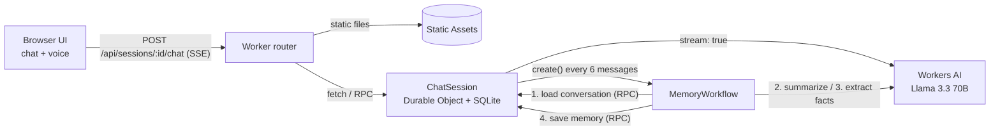

# Atlas: AI chat with long-term memory on Cloudflare

Atlas is a chat assistant that runs entirely on Cloudflare. It streams replies from **Llama 3.3 70B on Workers AI**, keeps each conversation in its own **SQLite-backed Durable Object**, and uses a **Cloudflare Workflow** to turn the conversation into long-term memory (a running summary and a list of facts about the user). You can type or talk to it in the browser, and it can read its replies aloud.

| Requirement             | Implementation |
| ----------------------- | -------------- |
| LLM                     | `@cf/meta/llama-3.3-70b-instruct-fp8-fast` on Workers AI (streaming chat and JSON-mode fact extraction) |
| Workflow / coordination | A Worker router, a `ChatSession` Durable Object that coordinates each session, and a `MemoryWorkflow` (Cloudflare Workflows) with retried steps |
| User input (chat/voice) | A static chat UI served by Workers Static Assets, with voice input (Web Speech API) and optional spoken replies |
| Memory / state          | Durable Object SQLite storage for messages, the conversation summary, user facts, and the workflow lock |

## Architecture



1. The browser creates a random session ID, saves it in `localStorage`, and sends messages to `/api/sessions/:id/chat`.
2. The Worker checks the input and sends the request to the `ChatSession` Durable Object for that session (`idFromName(sessionId)`).
3. The Durable Object saves the user message. It then builds a prompt from a system prompt, the long-term memory (summary and facts), and the most recent messages that fit a character budget. It streams the Llama 3.3 reply back to the browser as Server-Sent Events and saves the finished reply.
4. When 6 or more messages are not yet in memory, the Durable Object takes a lock and starts a `MemoryWorkflow` instance. You can also start one with the **Update memory now** button.
5. The Workflow runs four steps that can each be retried: load the new messages, update the running summary, extract and merge user facts (JSON mode), and save the result through RPC. If a step fails for good, the lock is released. Results from an old run (for example, after a session reset) are discarded.
6. The memory panel in the UI polls while a Workflow is running and shows the updated summary and facts when it finishes.

## Project structure

```
public/                 Static frontend (served by Workers Static Assets)
  index.html            Chat layout and memory side panel
  app.js                SSE streaming client, voice input/output, memory polling
  styles.css            UI styles
src/
  index.ts              Worker entry: API routing, validation, exports
  chat-session.ts       ChatSession Durable Object: storage, prompt building, streaming, workflow coordination
  memory-workflow.ts    MemoryWorkflow: summarize + extract facts with Llama 3.3, persist to the DO
wrangler.jsonc          Bindings: AI, Durable Object (SQLite), Workflow, Assets
```

## Prerequisites

- Node.js 18 or later
- A Cloudflare account. Workers AI runs remotely, even during local development, so you need to log in with `npx wrangler login`.

## Run locally

```bash
npm install
npx wrangler login
npm run dev
```

Open http://localhost:8787. Durable Objects and Workflows run locally. Workers AI calls go to your Cloudflare account.

> **Windows on ARM64:** `workerd` only ships an x64 Windows binary, which runs under emulation. Install with `npm install --cpu=x64`.

## Deploy

```bash
npm run deploy
```

Wrangler creates the Worker, the Durable Object class (migration `v1`), and the `atlas-memory-workflow` Workflow. Then it prints the `*.workers.dev` URL.

## Useful scripts

| Script               | Purpose |
| -------------------- | ------- |
| `npm run dev`        | Local development server |
| `npm run deploy`     | Deploy to Cloudflare |
| `npm run typecheck`  | TypeScript type check |
| `npm run build`      | Bundle without deploying (`wrangler deploy --dry-run`) |
| `npm run cf-typegen` | Regenerate `worker-configuration.d.ts` after changing bindings |

## HTTP API

All routes are scoped to a session ID (8–64 characters, letters, digits and `-`).

| Method   | Path                                  | Description |
| -------- | ------------------------------------- | ----------- |
| `GET`    | `/api/health`                         | Health check |
| `GET`    | `/api/sessions/:id`                   | Message history and memory |
| `POST`   | `/api/sessions/:id/chat`              | Body `{"message": "..."}`. Streams `text/event-stream` events: `start`, `token`, `done`, `error` |
| `GET`    | `/api/sessions/:id/memory`            | Summary, facts, number of messages not yet in memory, and Workflow status |
| `POST`   | `/api/sessions/:id/memory/refresh`    | Starts a memory Workflow right away |
| `DELETE` | `/api/sessions/:id`                   | Deletes the history and memory for the session |

Example:

```bash
curl -N -X POST http://localhost:8787/api/sessions/demo-session-1/chat \
  -H "content-type: application/json" \
  -d '{"message":"Hi, I am Sam and I love hiking."}'
```

## Configuration

You can change these constants at the top of [src/chat-session.ts](src/chat-session.ts):

- `MODEL`: the Workers AI model ID
- `MEMORY_TRIGGER_THRESHOLD`: how many new messages start a memory Workflow (default 6)
- `CONTEXT_MAX_MESSAGES` / `CONTEXT_CHAR_BUDGET`: how much recent history goes into each prompt
- `MAX_FACTS`: the maximum number of facts kept about the user

## Security notes

- The session ID works like a bearer token. Anyone who has it can read that session. This is fine for a demo. In production, put the app behind authentication (for example, Cloudflare Access) and derive the Durable Object name from the authenticated user.
- The server checks every input: session ID format, JSON content type (which forces a CORS preflight for cross-origin requests), and message length (4,000 characters at most).
- Model output is rendered with `textContent` and never as HTML, which prevents XSS.
